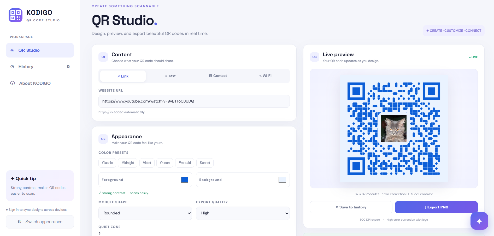
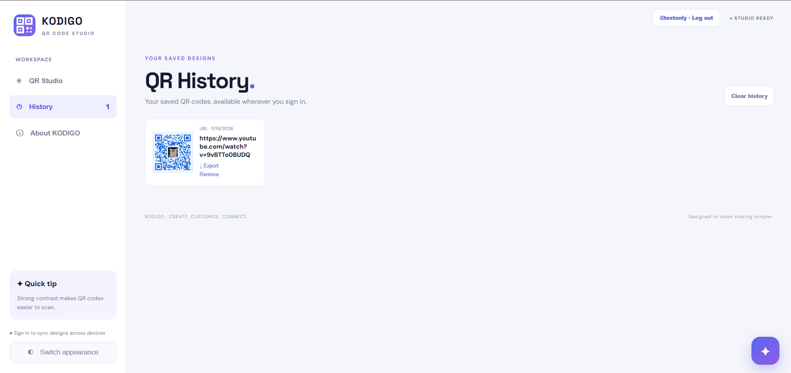

<p align="center">
  
</p>

<h1 align="center">KODIGO — QR Code Studio</h1>

<p align="center">
  <strong>Create. Customize. Connect.</strong><br>
  A QR code studio for creating useful, personalized QR codes on desktop or in your browser.
</p>

<p align="center">
  
  
  
  
  
</p>

---

## Overview

**KODIGO** is a customizable QR Code Studio available as a Python desktop application and a web application. It helps you turn links, messages, contact details, and Wi-Fi information into QR codes that are easy to preview, personalize, and share.

Choose a QR type, adjust its appearance, add an optional center logo, and export the result as a PNG. The web version also includes account-based QR history and **KODIGO AI**, an assistant for QR-related questions.

## Try the web app

**[Launch KODIGO](https://kodigo-joshy3.vercel.app)**

Create an account using a username and password to save QR codes to your account and access them across devices. Email registration and email verification are not required.

## Features

### QR code creation

| QR type | What it can contain |
|---|---|
| **Link** | Website URLs and other web links |
| **Text** | Notes, messages, and other plain text |
| **Contact** | Contact details formatted as a vCard |
| **Wi-Fi** | Network name, password, security type, and hidden-network setting |

### Customize your QR code

- Live preview while editing.
- Foreground and background color controls with ready-made color presets.
- Square, rounded, and dot module styles.
- Optional center logo upload (PNG, JPG, or WebP).
- Adjustable logo size and quiet zone.
- Contrast guidance to help create scannable designs.
- Standard, High, and Ultra PNG export quality.

### Web app features

- Responsive interface for desktop and mobile screens.
- Username-and-password sign up and login.
- Passwords are stored as secure hashes, not plain text.
- Save up to **100 QR codes** to your signed-in account.
- Access saved QR history across devices.
- Browser-local history when signed out.
- **KODIGO AI** assistant for QR code tips and practical guidance.

### Desktop app features

- Native desktop interface built with CustomTkinter.
- Local QR history with search, reopen, export, and delete options.
- Light and dark appearance modes.
- PNG export with 300 DPI metadata.
- QR readability protection, including high error correction when a center logo is used.

## Screenshots

### Web application

<p align="center">
  <a href="https://kodigo-joshy3.vercel.app">
    
  </a>
</p>
<p align="center">
  
</p>

## Technology stack

| Technology | Role in the project |
|---|---|
| **Python** | Main application language |
| **CustomTkinter** | Desktop user interface |
| **Flask** | Web application and API |
| **qrcode** | QR code generation |
| **Pillow** | Image rendering and processing |
| **SQLite** | Local desktop history |
| **PostgreSQL (Neon)** | Web accounts and cloud QR history |
| **JavaScript, HTML, CSS** | Web interface and interactions |
| **Gemini Developer API** | KODIGO AI assistant |
| **Vercel** | Web application hosting |

## Run KODIGO locally

### 1. Clone the repository

```bash
git clone https://github.com/joshuaarao42-arch/KODIGO.git
cd KODIGO
```

### 2. Set up the desktop application

Python 3.10 or newer is recommended.

```bash
py -m venv .venv
.\.venv\Scripts\activate
python -m pip install -r requirements-desktop.txt
python main.py
```

### 3. Run the web application

Install the web dependencies:

```bash
python -m pip install -r requirements.txt
```

Set the environment variables required by the services you want to use:

| Variable | Purpose |
|---|---|
| `DATABASE_URL` | Neon PostgreSQL connection string for account and cloud-history features |
| `FLASK_SECRET_KEY` | Long, random secret used to sign login sessions |
| `GEMINI_API_KEY` | Gemini API key for the KODIGO AI assistant |

Then start Flask:

```bash
python -m flask --app app run --debug
```

Open **http://127.0.0.1:5000** in your browser.

> **Note:** QR generation can be used without configuring the AI key. Account sign up, login, and cloud history require a working PostgreSQL connection and session secret. The AI assistant requires a valid Gemini API key. Keep all secrets in environment variables; never commit them to the repository.

## Deploy the web app to Vercel

1. Import [joshuaarao42-arch/KODIGO](https://github.com/joshuaarao42-arch/KODIGO) into Vercel.
2. Set the project root directory to the repository root.
3. Add the environment variables listed above under **Project Settings → Environment Variables**.
4. Enable the variables for the environments you plan to use.
5. Deploy or redeploy the project.

The live project is available at **[kodigo-joshy3.vercel.app](https://kodigo-joshy3.vercel.app)**.

The Gemini Developer API has usage limits. Availability and limits depend on the selected model and Google's current API policies.

## Build the Windows desktop application

On Windows, run:

```bat
build_exe.bat
```

The packaged application is created at:

```
dist/KODIGO/KODIGO.exe
```

## Keyboard shortcut

| Shortcut | Action | Version |
|---|---|---|
| `Ctrl + S` | Export the current QR code | Desktop |

## Project structure

```
KODIGO/
├── api/
│   └── index.py              # Flask API for the Vercel deployment
├── public/
│   ├── app.js                # Web app interactions
│   ├── styles.css            # Web app styles
│   └── favicon.svg           # KODIGO logo
├── templates/
│   └── index.html            # Web app interface
├── KODIGO/
│   ├── app.py                # Desktop application
│   ├── config.py
│   ├── database.py           # Desktop SQLite operations
│   ├── payloads.py           # QR content formatting
│   ├── qr_engine.py          # QR rendering
│   └── ui/                   # Desktop interface components
├── main.py                   # Desktop application entry point
├── app.py                    # Local Flask entry point
├── requirements.txt          # Web dependencies
├── requirements-desktop.txt  # Desktop dependencies
├── build_exe.bat             # Windows executable build script
└── README.md
```

## Privacy and security notes

- Desktop QR history is stored locally in SQLite.
- Signed-in web users' saved QR codes are stored in their account in PostgreSQL. Signed-out history is kept in that browser's local storage.
- Account passwords are hashed before they are stored.
- Uploaded center logos are processed for QR generation and are not saved as account files.
- A Wi-Fi QR code contains the network details encoded into it. Only share it with people you trust.
- Never commit API keys, database connection strings, passwords, real Wi-Fi credentials, or private contact details.

## Contributing

Contributions, suggestions, and bug reports are welcome.

1. Fork the repository.
2. Create a branch for your change.
3. Make your changes and test the affected features.
4. Open a pull request with a clear explanation of the update.

Please do not include secrets or private information in commits, screenshots, or test data.

## Author

**Joshua C. Arao**  
Computer Science student  
University of Science and Technology of Southern Philippines (USTP)

- GitHub: [@joshuaarao42-arch](https://github.com/joshuaarao42-arch)
- LinkedIn: [Joshua C. Arao](https://www.linkedin.com/in/arao-joshua-c-a60a67449/)

## License

This project is licensed under the **MIT License**. See the [LICENSE](LICENSE) file for details.
